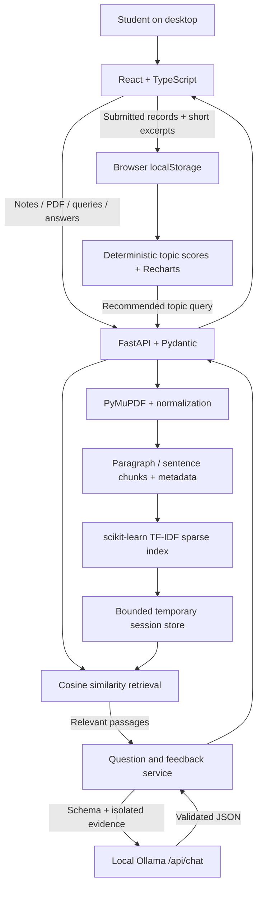

# studyAI

A free, local AI study workspace that turns lecture notes into practice questions and helps students decide what to review next. An overnight full-stack portfolio MVP built with React, TypeScript, FastAPI, and real scikit-learn retrieval.

**Status:** Stages 1–5 implemented. Automated NLP, quiz, dashboard, and HTTP integration checks pass. A live Ollama smoke run generated five questions and feedback for one submitted answer; desktop visual acceptance remains pending. The saved-materials library is a clearly labeled placeholder.

## Features

- Paste notes, upload a text-based multi-page PDF, or load clearly labeled original demo notes.
- Validate PDF type, size, pages, and readable text; explain the unsupported OCR requirement for scans.
- Search passages using TF-IDF and cosine similarity with source filename/page metadata.
- Generate 5 or 10 multiple-choice questions through local Ollama; validate JSON, reject obvious duplicates, and disclose partial generations.
- Require a written explanation, hide keys until submission, and lock submitted answers.
- Receive qualitative reasoning feedback, possible misconceptions, review topics, and retrieved evidence. Retry unavailable feedback independently of scoring.
- Inspect Recharts topic bars, answer accuracy, gap signals, review passages, and expandable feedback.
- Persist bounded submitted results in localStorage across refreshes; clear history independently of theme.
- Purple desktop interface, light/dark modes, loading states, and friendly local service errors.

No account, database, paid API key, or cloud inference is required. Initial dependency/model downloads need internet access.

## Tech stack

| Layer | Technology |
| --- | --- |
| Interface | React, strict TypeScript, Vite, Tailwind CSS, custom CSS |
| Visualization | Recharts |
| API and validation | Python, FastAPI, Pydantic |
| PDF extraction | PyMuPDF |
| Retrieval | scikit-learn TfidfVectorizer, cosine_similarity, sparse matrices |
| Local inference | Ollama HTTP API via httpx |
| Persistence | Bounded backend RAM; browser localStorage |
| Tests | Pytest/unittest, Node test runner, jsdom, real HTTP integration |

## Architecture



Backend routes stay thin; extraction/chunking, retrieval, sessions, Ollama transport, and practice logic are separate modules. The frontend separates pages, reusable quiz components, score calculations, storage validation, and API calls.

### TF-IDF retrieval

Unicode NFC and whitespace cleanup preserve technical notation, case, and paragraph boundaries. PDF bytes are extracted per page. Paragraph/sentence chunks target 180 words, with 25-word overlap for long windows.

Each session fits a real `TfidfVectorizer`: unigrams/bigrams, sublinear term frequency, smoothed IDF, L2 normalization, and a bounded vocabulary. TF captures frequency within a passage; IDF downweights terms common across passages. Technical tokens such as C++, C#, and Na+ are retained. Queries transform using the fitted vocabulary.

### Cosine similarity

Cosine similarity = dot(query, passage) / (length(query) × length(passage)). Nonnegative normalized TF-IDF vectors yield scores from 0 to 1. Passages rank by descending score; zero matches are omitted. Scores measure lexical relevance, **not confidence or student understanding**. Synonyms without shared words may not match.

Generation uses retrieved representative passages. Feedback retrieves context for the current question, topic, and correct option. Fixed system instructions and JSON-encoded untrusted evidence isolate document content. Citations must resolve to supplied chunk IDs. These checks reduce risks but cannot guarantee factual accuracy or perfect prompt-injection resistance. The adapter uses Ollama's [chat API and structured format](https://docs.ollama.com/api/chat).

## Windows installation

Prerequisites: Python 3.12, Node.js 24.15+ or 22.22.2+, and Ollama. Verified here with Python 3.12.10 and Node 24.21.0. Use PowerShell; `npm.cmd` avoids npm.ps1 execution-policy issues. Replace the example project path with your own checkout path.

### Backend

```powershell
Set-Location C:\Users\Hieu\studyAI\backend
py -3.12 -m venv .venv
.\.venv\Scripts\python.exe -m pip install -r requirements-dev.txt
.\.venv\Scripts\python.exe -m uvicorn main:app --host 127.0.0.1 --port 8000
```

If the Python launcher is unavailable, use `python -m venv .venv` with a Python 3.12 installation. Activation is optional. Run **one backend process** because sessions live in memory.

This workspace also has an ignored portable Python used for verification. It is not committed or required for a fresh clone. To run immediately here:

```powershell
Set-Location C:\Users\Hieu\studyAI\backend
..\.runtime\python\python.exe -m uvicorn main:app --host 127.0.0.1 --port 8000
```

### Frontend — another terminal

```powershell
Set-Location C:\Users\Hieu\studyAI\frontend
npm.cmd ci
npm.cmd run dev
```

Open **http://127.0.0.1:5173** in a window at least 1024px wide.

The managed agent environment denies esbuild parent-directory access during development optimization. Production builds work. For that permission issue, use the verified fallback:

```powershell
Set-Location C:\Users\Hieu\studyAI\frontend
npm.cmd run build
npm.cmd run preview
```

Preview uses port 5173, matching default backend CORS. Stop dev first. Preview has no hot reload and is for local verification.

### Ollama setup

Install [Ollama for Windows](https://docs.ollama.com/windows). Quit any running tray server before starting another instance. In a dedicated terminal:

```powershell
$env:OLLAMA_NO_CLOUD = "1"
ollama serve
```

In another terminal:

```powershell
ollama pull llama3.2:3b
ollama list
Invoke-RestMethod http://127.0.0.1:11434/api/tags
Invoke-RestMethod http://127.0.0.1:8000/health/ollama
```

Cloud disabling belongs in the **Ollama server** environment; restart after changes, as described in the [Ollama FAQ](https://docs.ollama.com/faq). FastAPI defaults to `llama3.2:3b`. Model availability does not verify generation quality: complete the manual workflow below. Download size and inference speed depend on the model/hardware.

### Configuration

See [.env.example](.env.example). Vite reads `frontend/.env`; copy the example there when overriding `VITE_API_BASE_URL`. Only `VITE_` variables are exposed to the browser.

**FastAPI does not automatically load .env files.** Set PowerShell process variables before starting Uvicorn:

```powershell
$env:OLLAMA_BASE_URL = "http://127.0.0.1:11434"
$env:OLLAMA_MODEL = "llama3.2:3b"
$env:OLLAMA_TIMEOUT_SECONDS = "120"
$env:OLLAMA_MAX_ATTEMPTS = "3"
$env:MAX_PDF_BYTES = "20971520"
$env:MAX_PDF_PAGES = "100"
$env:SESSION_TTL_SECONDS = "1800"
```

Ollama URLs must use loopback HTTP. Use a local model tag present in /api/tags. For another frontend port/origin, configure `FRONTEND_ORIGINS` in the backend.

## Try the full workflow

1. Open Start Studying → **Load sample notes**. The [original demo lecture](frontend/src/data/demo-lecture.txt) contains information-retrieval concepts, no private notes or prerecorded AI outputs.
2. **Process Material**. Search “inverse document frequency” to see real passages/scores. Alternatively use a text-based PDF; scans show an OCR limitation error.
3. Confirm Ollama availability, select 5 or 10, and **Generate Questions**. Limited retries may produce fewer questions.
4. Select an answer and write at least ten characters of reasoning. Submit, inspect the locked score and separate AI estimate, then advance.
5. View Dashboard scores, topic bars, gap signals, expanded feedback, and **Find passages in my notes**.
6. Refresh at the same origin. Submitted records persist; active quizzes/source indexes are not durably persisted. Reprocess matching notes if targeted retrieval is unavailable.
7. **Clear saved results** resets history. **Clear session** deletes the temporary index; theme settings remain independent.

Accuracy compares selected and stored answer indices. AI judgments never change it, but a model-generated key can itself be wrong. Topic estimates include submitted questions in partial attempts. At least one incorrect answer or recurring qualitative concern across two questions creates a review signal. Recommendations aggregate signals and model-suggested review topics; there is no adaptive difficulty algorithm or generated study plan.

## Data lifecycle

- Uploaded files are not permanently saved. PyMuPDF reads bytes; extraction/indexing stay in memory, and upload handles close on success/failure. Multipart handling can use an OS temporary spool file, not a retained document store.
- Defaults: 20 MiB PDF, 100 pages, 100,000 pasted characters, 1,000,000 extracted characters, 2,000 chunks, 20,000 features. Two material uploads and one model chat can run concurrently.
- Fixed 30-minute session expiry; cleanup every 30 seconds/on lookup, explicit deletion, and shutdown. Defaults bound sessions to 8, estimated total storage to 64 MiB, and per-session storage with quiz reservation. Admission estimates do not guarantee process RSS.
- Browser history: at most 20 attempts and 750,000 UTF-16 units. Whitelisted submitted records and source excerpts up to 1,500 Unicode characters. No original PDFs, full input fields, or unsubmitted keys.
- Invalid saved data is reported/preserved until explicit clear. Quota pruning is disclosed; blocked storage preserves in-memory results and explains refresh risk. Cached summaries are recalculated.
- localStorage belongs to the browser/profile/origin. Written explanations and short excerpts may still be sensitive; clear history on shared computers. No app telemetry or external document service.

## Testing

```powershell
Set-Location C:\Users\Hieu\studyAI\backend
.\.venv\Scripts\python.exe -m pytest -q
.\.venv\Scripts\python.exe check_health.py

Set-Location C:\Users\Hieu\studyAI\frontend
npm.cmd run test
npm.cmd run test:integration
npm.cmd run typecheck
npm.cmd run build
```

The integration test auto-detects backend/.venv or this workspace's portable runtime and owns ephemeral loopback servers. Override its Python path using `$env:STUDYAI_TEST_PYTHON` if needed.

Stage 5: **54 backend tests + 29 unittest subtests, 38 frontend tests, and one full HTTP integration test passed**. TypeScript, production build, backend health/CORS, and production asset HTTP checks passed. A live model smoke run passed; it does not establish model accuracy or educational impact. [Test evidence and manual acceptance](docs/TESTING.md).

## Screenshots

Actual desktop captures are pending. [Screenshot placeholders](docs/screenshots/README.md) cover study input, locked feedback, and light/dark dashboard views. No mock screenshot is presented as real quiz output.

## Known limitations

- Extended real-model acceptance across 10-question sets, edge cases, and desktop rendering remains pending. The five-question/one-feedback smoke run does not establish accuracy, latency benchmarks, or learning improvement.
- No enabled browser automation surface for visual acceptance. jsdom verifies interactions/chart SVGs; manual desktop layout review remains.
- Desktop only; no OCR, authentication, durable material library, multi-worker sessions, or active-quiz recovery across full refresh.
- Lexical retrieval has limited semantic matching; bounded context may miss parts of a lecture. Duplicate detection is heuristic.
- Valid schemas/citation IDs do not establish truth. Model judgments/topic labels can be inconsistent. Insights do not diagnose understanding.
- Source sessions can expire before archived results; reprocess notes for targeted review passages.
- Dev optimizer hits managed-environment permissions; build/preview works.
- Backend tooling emits one nonblocking Starlette/httpx deprecation warning.

## GitHub and resume

See [resume verification](docs/RESUME_VERIFICATION.md) and [publication checklist](docs/GITHUB_CHECKLIST.md). This workspace is not yet a Git repository. Publishable source was reviewed for private material and credential patterns; no private lecture files or hardcoded API secrets were found. Ignored local runtimes/dependencies are excluded. No commit or push was performed.
